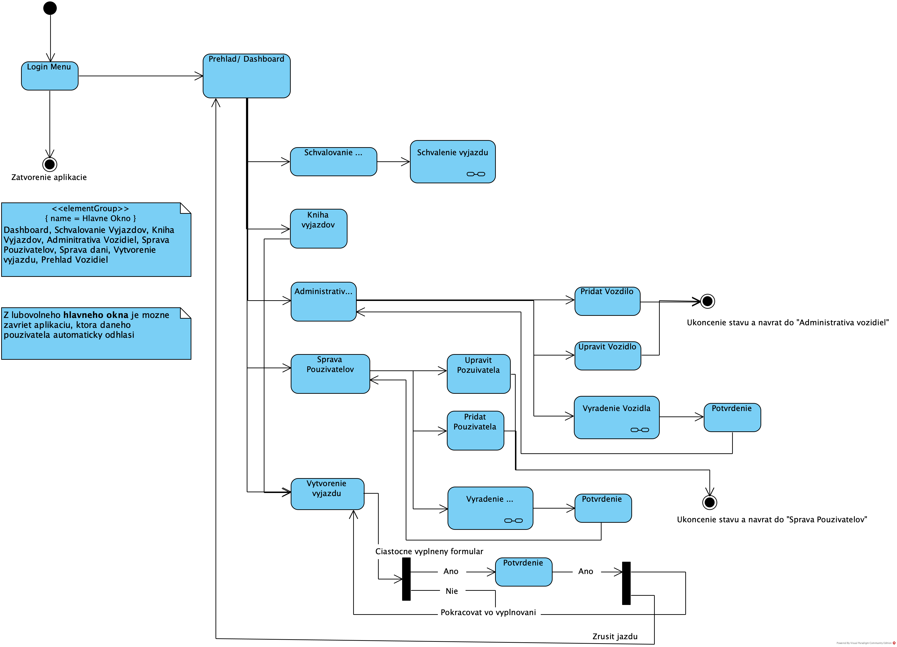
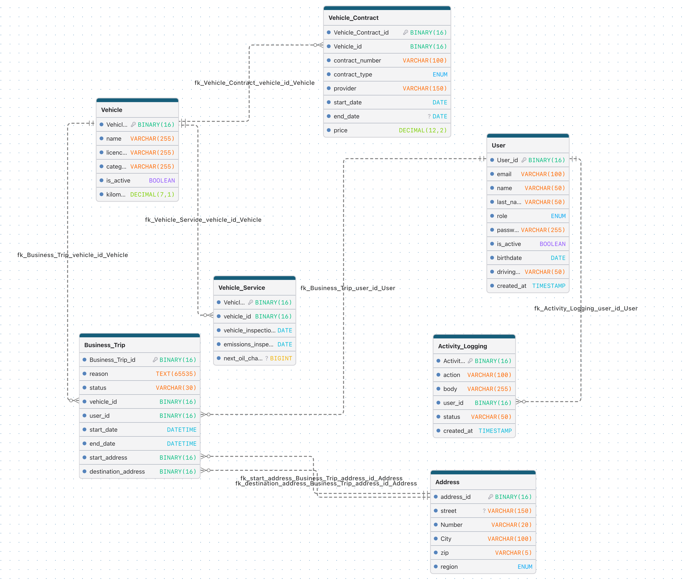

# eWheel
eWheel is a school project for course paz1c. It is a system for vehicle registration and managemnt coupled with dispatch logbook

This project was made in collaboration with @CaptainRepus (See authors for more information).
## Navigation

To best describe our app and navigation we've prepared detailed diagram explaining navigation between stages/scenes

>[!IMPORTANT]
>
> GUI TASKS:
> - [x] Vytvorit Login Page
> - [x] Vytvorit DashBoard Main Stage
> - [x] Vytvorit DashBoard Layout Scene
> - [x] Vytvorit Schvalovanie vyjazdov / Kniha jazd
> - [ ] Vytvorit Administrativu vozidiel
> - [ ] Vytvorit Administraciu Pouzivatelov
>
> Samostatne okna:
>
> - [ ] Vytvorit vytvorit vyjazdu
> - [ ] Pridat Vozidla / Upravit vozidlo
> - [ ] Pridat pouzivatela / Upravit pouzivatela
> 
> Dialogove okna:
> 
> - [x] Dialog pre Vyradenie vozdila a pouzivatela
> - [x] Dialog pre Potvrdenie vytvorenia vyjazdu

> [!CAUTION]
> Okna nemaju diakritiku ani zadane id as of 5.11.2026 :face_exhaling:

*by eWheel*

### Database schema

Schema that will be used to store data for our application

>[!IMPORTANT]
>Tasky pre @CpatainRepus :shamrock:
>
>uz je tu aj DDL databazy v sql fomrate
>
>Upravit databazu nasledovne: :raised_hands:
>
> - [ ] Tabulka Vehicle_Service potrebne aby tam boli kategorie (stk/ek (kedy bola vykonana), vymena oleja, vymena ..., ...) pravdepodobne to vyriesit cez ciselnik, aby datum servisu bol samostatne pre kazdy ukon, avsak premyslam nad tym ze ak mas vymena oleja checkovanie brzd atd vies to urobit na jeden datum (m:n) na ciselnik, uz necham na teba
> - [ ] Datum expiracie stk/ek pridat do tabulky Vehicle (ako spominal vilo ze by to chcel amt hned tento udaj)
> - [ ] Activity logging ako cislenik (?, vravel si ze je to pre usera basically ctrl+z?)
> - [ ] Do contract pridat pociatocne_km a predavajuce_km (nech neprepocitavas) [na desatinne cisla pouzivaj decimal]
>
>Bussiness Trip tabulka zmeny: :raised_hands:
>
>- [ ] status varchar → enum (approved, denied, pending);
>- [ ] reason text(65535) --> ciselnik (..., Other spravi to ze ponukne text field varchar(255) by malo byt dost)
>- [ ] pridat atribut reason_text varchar(255) (tento moze byt null)
>
> Overall zmenit tie nazvy PK idcok ako lukas spominal ("staci iba *id* ako nazov pre pk")
>
> Nasledne tu uploadni png final verziu (s bielym pozadim) po tom co ti to odsuhlasi mino :heart: :heart_hands:
> 
> nezabudni **update** na [ddl-Script](ewheel_ddl.sql)

*by eWheel*